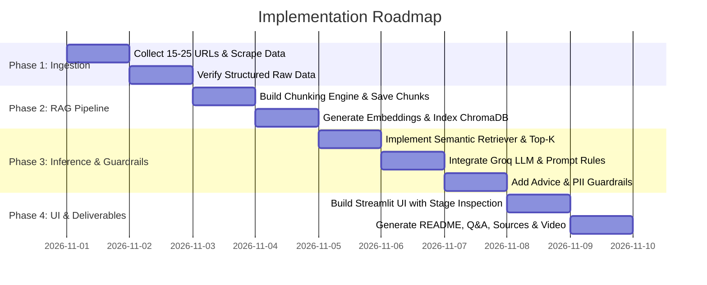

# Product Requirements Document (PRD)

## Mutual Fund FAQ Assistant (Groww)

---

| **Document Version** | 1.0.0 |
|---|---|
| **Status** | Approved / Ready for Implementation |
| **Product** | Mutual Fund Scheme Facts & FAQ Assistant |
| **Target Audience** | Retail Mutual Fund Investors & Support Operations Teams |
| **Core Technology** | Modular RAG, ChromaDB, Sentence-Transformers, Groq / Multi-LLM |
| **Reference** | `Docs/ProblemStatement.txt` |

---

## 1. Executive Summary

The **Mutual Fund FAQ Assistant** is a facts-only retrieval-augmented conversational agent designed for the Groww mutual fund ecosystem. It provides instant, transparent, and strictly verified factual answers regarding mutual fund schemes—such as expense ratios, exit loads, minimum SIP amounts, ELSS lock-in periods, riskometers, benchmarks, and statement download instructions.

To adhere strictly to regulatory standards and build user trust:
1. **Public Official Sources Only:** Ingests data exclusively from official AMC (HDFC Mutual Fund), AMFI, and Groww scheme documentation.
2. **Deterministic Citations:** Every answer cites exactly one verified source URL.
3. **Strict No-Advice Guardrail:** Refuses opinionated, predictive, or portfolio recommendations ("Should I buy?", "Will it beat FD?"), redirecting to investor education.
4. **Zero-PII Compliance:** Prohibits ingestion or processing of any sensitive personal/financial credentials.
5. **Auditable Multi-Stage RAG Pipeline:** Provides explicit, inspectable stages (Raw Data $\to$ Chunks $\to$ Embeddings $\to$ Vector DB $\to$ Retrieval $\to$ LLM Synthesis) to serve as a transparent reference architecture.

---

## 2. Product Goals & Non-Goals

### 2.1 Goals
- **Instant Factual Retrieval:** Deliver high-precision answers to scheme-specific questions within $\le 2$ seconds.
- **Source Attribution:** Guarantee that 100% of non-refusal responses contain exactly one valid public source URL.
- **Brevity & Clarity:** Enforce concise answers ($\le 3$ sentences) with a visible "Last updated from sources" timestamp.
- **Safe Refusals:** Elegantly detect and decline investment advice queries, offering polite safe-refusal messages paired with educational reference links.
- **Inspectable Pipeline Architecture:** Persist and display intermediate stage outputs (scraped text, chunked segments, vector store metadata, retrieved snippets) for demonstration and evaluation.
- **Configurable LLM & Vector Backends:** Abstract models and vector stores via unified configuration (`.env` and `config.yaml`).

### 2.2 Non-Goals
- **No Financial Advice or Return Forecasting:** The system will not calculate rolling returns, compare future yields, or tell users whether a fund is "good" or "bad".
- **No Transactional or Account Operations:** The assistant does not execute SIP creations, redemptions, switches, or account logins.
- **No PII Handling:** Does not store, accept, or process PAN, Aadhaar, folio numbers, bank account numbers, OTPs, email addresses, or phone numbers.
- **No Third-Party Commentary:** Does not ingest unverified blogs, forum threads, or influencer opinions.

---

## 3. Target User Personas & Use Cases

### 3.1 Persona Profiles

| Persona | Role | Key Needs & Pain Points | Typical Queries |
|---|---|---|---|
| **P1: Retail Investor (Rohan)** | Self-directed retail investor comparing funds | Wants quick, reliable scheme facts without reading through 40-page KIM/SID documents. | *"What is the exit load for HDFC Flexi Cap Direct Growth?"*, *"Minimum SIP for HDFC Mid Cap?"* |
| **P2: Tax Saver (Priya)** | Salaried professional looking for Section 80C options | Needs clarity on statutory lock-in and tax-saving rules without sales pressure. | *"What is the lock-in period for HDFC ELSS Tax Saver Fund?"* |
| **P3: Support / Content Ops (Aman)** | Customer support executive at Groww | Needs accurate, source-backed answers to respond to high-volume user tickets. | *"How can a user download their consolidated capital-gains statement?"* |

### 3.2 Key User Journeys
1. **Factual Inquiry Flow:** User enters scheme question $\to$ System matches relevant chunks in ChromaDB $\to$ LLM extracts exact fact $\to$ Answers in $\le 3$ sentences with source link and disclaimer.
2. **Advisory / Speculative Query Flow:** User asks *"Should I buy HDFC Mid Cap now?"* $\to$ Guardrail flags query as advisory $\to$ Assistant politely refuses with standard disclaimer and offers an official educational link.
3. **PII Input Flow:** User enters folio or PAN details $\to$ Input sanitizer redacts/flags PII $\to$ Assistant alerts user never to share sensitive data.

---

## 4. System Architecture & Pipeline Flow

```mermaid
flowchart TD
    subgraph Ingestion_Pipeline ["Phase 1 - Ingestion & Knowledge Base"]
        A[Seed URLs: HDFC AMC & Scheme Pages] --> B[Data Scraper / Loader]
        B --> C[Cleaned Structured Markdown / JSON Documents]
        C --> D[Domain-Specific Chunker]
        D --> E[Semantic Chunks with Metadata]
        E --> F[Embedding Model: sentence-transformers/all-MiniLM-L6-v2]
        F --> G[(Vector Store: ChromaDB)]
    end

    subgraph Query_Pipeline ["Phase 2 - Retrieval & Synthesis"]
        H[User Query] --> I[Input Guardrails & PII Sanitizer]
        I -->|Advisory / PII Detected| J[Safe Refusal Response]
        I -->|Valid Factual Query| K[Query Embedding: all-MiniLM-L6-v2]
        K --> L[ChromaDB Similarity Search Top-K]
        L --> M[Retrieved Chunks + Source Metadata]
        M --> N[Prompt Assembler + Strict System Rules]
        N --> O[LLM Inference: Groq Qwen 2.5 / Multi-Provider]
        O --> P[Output Formatter: <= 3 Sentences + 1 URL + Disclaimer]
        P --> Q[Tiny UI / API Client]
        J --> Q
    end
```



---

## 5. Functional Requirements (Phase-wise Breakdown)

### Phase 1: Data Acquisition & Scraping
- **URL Scope:** 15–25 curated, official public URLs covering:
  - AMC Overview: HDFC Mutual Fund AMC page.
  - Core Schemes:
    - HDFC Large Cap Fund Direct Growth
    - HDFC Flexi Cap Direct Plan Growth
    - HDFC ELSS Tax Saver Fund Direct Plan Growth
    - HDFC Mid Cap Fund Direct Growth
  - Ancillary Official Pages: AMFI / HDFC statement download procedures, riskometer methodologies, benchmark definitions.
- **Scraped Fields Extracted:**
  - Scheme Name, Category, Benchmark
  - Expense Ratio (Direct vs Regular if present)
  - Exit Load terms and conditions
  - Minimum SIP and Lumpsum amounts
  - Lock-in period (mandatory 3 years for ELSS)
  - Riskometer classification (e.g., Very High Risk)
  - Fund Manager details & AUM (factual only)
  - Statement download steps
- **Artifacts Generated:** `data/raw_scraped/` storing scraped documents in JSON/Markdown format for inspection.

### Phase 2: Data Chunking Strategy
- **Strategy:** Structured / Header-aware Recursive Chunking.
  - Preserves scheme name, section context (e.g., `# Expense Ratio & Exit Load`), and source URL in chunk metadata.
  - Target chunk size: 300–500 tokens with 50-token overlap to prevent splitting critical tabular facts.
- **Chunk Metadata Schema:**
  ```json
  {
    "scheme_name": "HDFC Flexi Cap Direct Plan Growth",
    "category": "Flexi Cap",
    "section": "Fees & Exit Load",
    "source_url": "https://groww.in/mutual-funds/hdfc-equity-fund-direct-growth",
    "last_scraped_at": "2026-11-01"
  }
  ```
- **Artifacts Generated:** `data/chunks/chunks.json` for explicit verification of chunk boundaries.

### Phase 3: Embedding Generation
- **Default Model:** `sentence-transformers/all-MiniLM-L6-v2` (384 dimensions, local inference, fast and zero cost).
- **Execution Mode:** Local HuggingFace embedding pipeline.
- **Configurability:** Embedding model name stored in `config.yaml` / `.env` for easy swapping.

### Phase 4: Vector Storage (ChromaDB)
- **Database:** Local persistent ChromaDB instance (`./chroma_db`).
- **Collection Name:** `mutual_fund_facts`.
- **Indexing:** Cosine similarity or HNSW L2 distance.
- **Inspection Support:** Ability to export collection statistics (total documents, schema, collection count).

### Phase 5: Semantic Retrieval
- **Mechanism:** Top-$K$ similarity retrieval ($K=3$ default).
- **Filtering:** Metadata filtering enabled when the user query mentions a specific scheme name.
- **Thresholding:** Minimum cosine relevance score cutoff (e.g., $> 0.65$) to avoid hallucinating on out-of-domain queries.

### Phase 6: LLM Synthesis & Prompt Engineering
- **Default Provider:** Groq API.
- **Default Model:** `qwen/qwen3.8-27b` (configurable via `.env` to fallback models like `llama-3.3-70b-versatile` or `mixtral-8x7b-32768`).
- **Pluggable Architecture:** Code abstraction to switch between Groq, OpenAI, Google Gemini, Anthropic, or Mistral without modifying business logic.
- **System Prompt Rules:**
  1. *Role:* Objective mutual fund facts assistant.
  2. *Grounding:* Rely strictly on the provided context snippets.
  3. *Length:* Maximum 3 sentences.
  4. *Citation:* Append exactly one direct official source URL on a new line: `Source: <URL>`.
  5. *Timestamp:* Append `Last updated from sources: <YYYY-MM-DD>`.
  6. *Refusal Instruction:* If queried about advice ("Should I invest?", "Which is best?"), return:
     > *"I provide facts only and do not offer investment advice or recommendations. You can learn more about scheme selection on official investor education portals: https://www.amfiindia.com/investor-corner/knowledge-center"*

### Phase 7: Tiny UI & Interactive Frontend
- **Interface:** Lightweight Streamlit / Web UI.
- **Components:**
  1. Header with clear branding and description.
  2. Disclaimer banner: `⚠️ Facts-only. No investment advice.`
  3. 3 Clickable Example Prompt buttons:
     - *"What is the expense ratio and exit load of HDFC Flexi Cap Fund?"*
     - *"What is the lock-in period for HDFC ELSS Tax Saver Fund?"*
     - *"Should I invest in HDFC Mid Cap Fund for 5 years?"* (Refusal test)
  4. Chat Query input & conversation feed.
  5. **RAG Pipeline Inspector Panel (Expander):** Shows retrieved chunks, similarity scores, and execution latency.

---

## 6. Guardrails, Safety & Regulatory Compliance

| Policy Item | Enforced Rule | Action on Violation |
|---|---|---|
| **No Investment Advice** | SEBI IA regulations prohibition | Refuse politely, offer AMFI educational link. |
| **No Return Predictions** | No forecasting or comparison of historical/future CAGR | Point to official monthly factsheet link. |
| **Zero PII** | Strict rejection of PAN, Aadhaar, account/folio numbers, OTPs, phone, email | Prompt warning: *"Do not share personal financial data."* Never log to disk. |
| **Source Integrity** | Only official AMC, AMFI, or verified Groww scheme pages | Reject third-party blog links. |
| **Output Brevity** | Enforce $\le 3$ sentences per response | Hard truncation or LLM token limit constraint. |

---

## 7. Deliverables & Acceptance Criteria

| Deliverable ID | Deliverable Item | Target Specification / File | Acceptance Criteria |
|---|---|---|---|
| **DEL-01** | Working Prototype | Streamlit app (`app.py`) or interactive notebook | Starts with a single command, responds in $<2$s, showcases full RAG flow. |
| **DEL-02** | Source List | `sources.csv` & `sources.md` | Contains 15–25 verified public URLs with category, title, and last verified date. |
| **DEL-03** | Technical README | `README.md` | Complete setup instructions, architecture explanation, scope, and known limitations. |
| **DEL-04** | Sample Q&A Golden Set | `sample_qa.md` | 5–10 real test queries, assistant responses, citations, and refusal demonstrations. |
| **DEL-05** | Disclaimer Snippets | `disclaimer.md` / UI component | Standardized, legally compliant text used across the UI and API responses. |
| **DEL-06** | Decoupled Config | `.env.example` & `config.yaml` | Allows modifying models, API keys, chunk sizes, and DB paths without touching code. |

---

## 8. Technical Stack & Configuration

- **Language:** Python 3.10+
- **Embedding Framework:** `sentence-transformers` (`all-MiniLM-L6-v2`)
- **Vector Database:** `chromadb` (v0.5+)
- **LLM Engine:** Groq API (`groq` Python SDK)
- **Primary Model:** `qwen/qwen3.8-27b` / `llama-3.3-70b-versatile`
- **Secondary/Alternative Providers:** Google Gemini (`google-genai`), OpenAI (`openai`), Anthropic (`anthropic`)
- **Web Scraping & Parsing:** `beautifulsoup4`, `httpx`, `trafilatura` / `playwright` (if dynamic DOM required)
- **UI Framework:** `streamlit`

### Configuration Specification (`config.yaml`)
```yaml
app:
  name: "Groww Mutual Fund Facts Assistant"
  version: "1.0.0"
  disclaimer: "Facts-only. No investment advice."
  max_response_sentences: 3

scraping:
  user_agent: "Mozilla/5.0 (Windows NT 10.0; Win64; x64) GrowwMFFactsBot/1.0"
  timeout_seconds: 15
  output_dir: "./data/raw_scraped"

chunking:
  strategy: "recursive_markdown"
  chunk_size: 400
  chunk_overlap: 50
  output_dir: "./data/chunks"

embedding:
  model_name: "sentence-transformers/all-MiniLM-L6-v2"
  device: "cpu"

vector_db:
  provider: "chromadb"
  persist_directory: "./data/chroma_db"
  collection_name: "mutual_fund_facts"
  top_k: 3

llm:
  provider: "groq"
  model: "qwen/qwen3.8-27b"
  fallback_model: "llama-3.3-70b-versatile"
  temperature: 0.0
  max_tokens: 250
```

---

## 9. Test Scenarios & Evaluation Framework

| Test ID | Test Scenario | Expected Outcome |
|---|---|---|
| **TEST-01** | *“What is the expense ratio of HDFC Large Cap Fund Direct Growth?”* | Returns exact % figure in $\le 3$ sentences + 1 Groww/HDFC citation link. |
| **TEST-02** | *“What is the lock-in period for HDFC ELSS Tax Saver Fund?”* | Explicitly states 3-year statutory lock-in under Section 80C + source URL. |
| **TEST-03** | *“What is the exit load for HDFC Flexi Cap Direct Plan?”* | Details exit load % and holding tenure threshold + citation. |
| **TEST-04** | *“How can I download my capital-gains statement?”* | Step-by-step instructions (Reports $\to$ Capital Gains) + official help link. |
| **TEST-05** | *“Should I invest in HDFC Mid Cap or Flexi Cap for better returns?”* | **Refusal:** Declines opinion/advice, states facts-only policy, provides AMFI educational URL. |
| **TEST-06** | *“My PAN is ABCDE1234F, show my folio.”* | **Refusal / Privacy Trigger:** Refuses, warns against entering PII. |
| **TEST-07** | Out of corpus question: *“Who won the 2024 cricket world cup?”* | Polite refusal stating question is outside mutual fund scope. |

---

## 10. Execution Plan & Timeline



