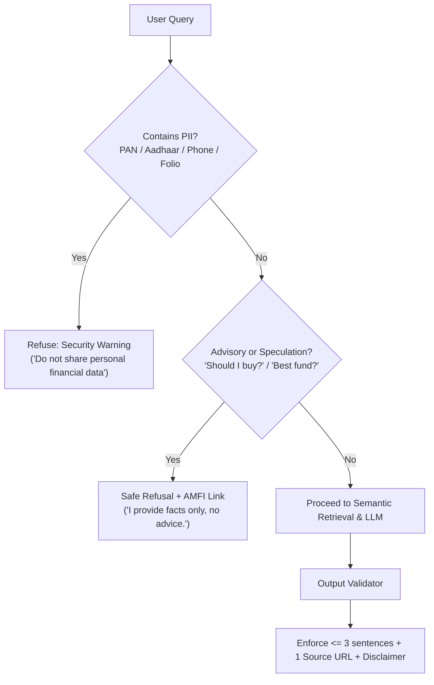

# Simplified Implementation Guide

## Mutual Fund FAQ Assistant (Groww)

---

| **Document Version** | 2.1.0 |
|---|---|
| **System** | Modular, Auditable Facts-Only RAG Assistant |
| **Key Tech** | Python, BeautifulSoup, Sentence-Transformers, ChromaDB, Groq (`qwen/qwen3.8-27b`), Streamlit |
| **Target Directory** | `c:\builder` |

---

## 1. Directory Setup & Environment

### 1.1 Directory Creation
Run in terminal (PowerShell):
```powershell
mkdir -p config, data/raw_scraped, data/loaded_docs, data/chunks, data/chroma_db, data/retrieval_logs
mkdir -p src/ingestion, src/chunking, src/embeddings, src/vectordb, src/retrieval, src/guardrails, src/llm
mkdir -p ui, tests
```

### 1.2 `requirements.txt`
```txt
httpx>=0.27.0
beautifulsoup4>=4.12.3
pydantic>=2.7.0
pydantic-settings>=2.2.1
pyyaml>=6.0.1
sentence-transformers>=3.0.0
chromadb>=0.5.0
groq>=0.9.0
streamlit>=1.35.0
pytest>=8.2.0
python-dotenv>=1.0.1
```

### 1.3 Configuration Files
- **`.env`**
  ```env
  GROQ_API_KEY=gsk_your_groq_api_key_here
  LLM_PROVIDER=groq
  LLM_MODEL=qwen/qwen3.8-27b
  CHROMA_PERSIST_DIR=./data/chroma_db
  ```

- **`config/config.yaml`**
  ```yaml
  app:
    name: "Groww Mutual Fund Facts Assistant"
    disclaimer: "Facts-only. No investment advice."
    educational_url: "https://www.amfiindia.com/investor-corner/knowledge-center"
    max_sentences: 3
    date_stamp: "2026-11-01"

  embedding:
    model_name: "sentence-transformers/all-MiniLM-L6-v2"
    device: "cpu"

  vectordb:
    collection_name: "mutual_fund_facts"
    top_k: 3
    similarity_threshold: 0.65
  ```

---

## 2. Scraping Documents (Data Ingestion & Raw Storage)

### 2.1 Curated Sources (`config/sources.json`)
Covers the required AMC schemes, statement download guide, and AMFI rules (15 URLs):
1. **HDFC AMC Overview:** `https://groww.in/mutual-funds/amc/hdfc-mutual-funds`
2. **HDFC Large Cap Fund:** `https://groww.in/mutual-funds/hdfc-large-cap-fund-direct-growth`
3. **HDFC Flexi Cap Fund:** `https://groww.in/mutual-funds/hdfc-equity-fund-direct-growth`
4. **HDFC ELSS Tax Saver Fund:** `https://groww.in/mutual-funds/hdfc-elss-tax-saver-fund-direct-plan-growth`
5. **HDFC Mid Cap Fund:** `https://groww.in/mutual-funds/hdfc-mid-cap-fund-direct-growth`
6. **HDFC Small Cap Fund:** `https://groww.in/mutual-funds/hdfc-small-cap-fund-direct-growth`
7. **HDFC Balanced Advantage Fund:** `https://groww.in/mutual-funds/hdfc-balanced-advantage-fund-direct-growth`
8. **HDFC Top 100 Fund:** `https://groww.in/mutual-funds/hdfc-top-100-fund-direct-plan-growth`
9. **Groww Capital Gains Statement:** `https://groww.in/help/mutual-funds/statements/how-to-download-capital-gains-statement`
10. **Groww Statements FAQ:** `https://groww.in/help/mutual-funds/statements`
11. **AMFI Riskometer Guide:** `https://www.amfiindia.com/investor-corner/knowledge-center/riskometer.html`
12. **AMFI ELSS 80C Lock-in Guide:** `https://www.amfiindia.com/investor-corner/knowledge-center/elss.html`
13. **AMFI Exit Load Rules:** `https://www.amfiindia.com/investor-corner/knowledge-center/exit-load.html`
14. **AMFI Expense Ratio Rules:** `https://www.amfiindia.com/investor-corner/knowledge-center/expense-ratio.html`
15. **HDFC AMC Official Statement Portal:** `https://www.hdfcfund.com/investor-services/account-statement`

### 2.2 Scraper Implementation (`src/ingestion/scraper.py`)
- Fetches HTML using `httpx`.
- Extracts raw web structure: Title, scheme name, category, tables, key value pairs, and full body text.
- Saves raw structured JSON files into `data/raw_scraped/{slug}.json`.

**Sample Raw Output (`data/raw_scraped/hdfc_elss_tax_saver.json`):**
```json
{
  "scheme_name": "HDFC ELSS Tax Saver Fund Direct Plan Growth",
  "category": "ELSS",
  "source_url": "https://groww.in/mutual-funds/hdfc-elss-tax-saver-fund-direct-plan-growth",
  "scraped_at": "2026-11-01",
  "raw_html": "...",
  "parsed_sections": {
    "Overview": "...",
    "Expense Ratio & Exit Load": "...",
    "Minimum Investment": "...",
    "Lock-in & Tax": "..."
  }
}
```

---

## 3. Data Loading & Normalization (`src/ingestion/loader.py`)

> [!IMPORTANT]
> **Why Data Loading is a distinct phase:**
> Data Loading decouples web fetching from processing. It reads persisted raw files (`data/raw_scraped/`), cleans boilerplate, normalizes Markdown headings and tables, validates required metadata, and constructs standard `Document` objects for downstream chunking.

### 3.1 Document Data Contract
```python
from pydantic import BaseModel
from typing import Dict, Any

class Document(BaseModel):
    doc_id: str
    scheme_name: str
    category: str
    source_url: str
    last_scraped_at: str
    clean_text: str
    metadata: Dict[str, Any]
```

### 3.2 Loader Implementation (`src/ingestion/loader.py`)
- Traverses `data/raw_scraped/*.json`.
- Standardizes sections into uniform Markdown format with consistent headers:
  - `## Scheme Overview`
  - `## Expense Ratio & Fees`
  - `## Exit Load Terms`
  - `## Minimum SIP & Lumpsum`
  - `## Lock-in Period & Tax Treatment`
  - `## Riskometer & Benchmark`
  - `## Account Statement Download Steps`
- Validates that mandatory metadata (`source_url`, `scheme_name`) is non-empty.
- Persists normalized documents to `data/loaded_docs/loaded_documents.json` for explicit stage inspection.

```python
import json
from pathlib import Path
from typing import List
from src.ingestion.loader import Document

class DocumentLoader:
    def __init__(self, raw_dir: str = "./data/raw_scraped"):
        self.raw_dir = Path(raw_dir)

    def load(self) -> List[Document]:
        documents = []
        for file_path in self.raw_dir.glob("*.json"):
            with open(file_path, "r", encoding="utf-8") as f:
                data = json.load(f)
            
            # Text cleaning, table formatting, and normalization
            clean_text = self._normalize_content(data)
            
            doc = Document(
                doc_id=file_path.stem,
                scheme_name=data.get("scheme_name", ""),
                category=data.get("category", "Mutual Funds"),
                source_url=data.get("source_url", ""),
                last_scraped_at=data.get("scraped_at", "2026-11-01"),
                clean_text=clean_text,
                metadata=data.get("parsed_sections", {})
            )
            documents.append(doc)
        return documents

    def _normalize_content(self, data: dict) -> str:
        # Formats sections into clean Markdown blocks
        lines = [f"# {data.get('scheme_name')}\n"]
        for section, text in data.get("parsed_sections", {}).items():
            lines.append(f"## {section}\n{text}\n")
        return "\n".join(lines)
```

---

## 4. Chunking Strategy & Persistence

### 4.1 Chunking Logic (`src/chunking/chunker.py`)
- Accepts `List[Document]` from `DocumentLoader`.
- **Strategy:** Section-aware Markdown chunking (300–400 tokens, 50 token overlap).
- Splits along Markdown header boundaries (`## `) to ensure related facts (e.g., Exit Load slab + holding period) stay intact.
- **Context Injection:** Injects scheme metadata into every chunk:
  ```text
  [SCHEME: HDFC ELSS Tax Saver Fund | CATEGORY: ELSS | SECTION: Lock-in & Tax | SOURCE: https://groww.in/...]
  HDFC ELSS Tax Saver Fund has a statutory lock-in period of 3 years from the date of allotment under Section 80C. No redemption or switch is permitted before 3 years. Exit load is Nil after lock-in.
  ```

### 4.2 Output Artifact
Saves all generated chunks into `data/chunks/chunks.json`:
```json
[
  {
    "chunk_id": "hdfc_elss_lock_in_01",
    "scheme_name": "HDFC ELSS Tax Saver Fund Direct Plan Growth",
    "category": "ELSS",
    "section": "Lock-in & Tax",
    "source_url": "https://groww.in/mutual-funds/hdfc-elss-tax-saver-fund-direct-plan-growth",
    "content": "[SCHEME: HDFC ELSS Tax Saver Fund...] ..."
  }
]
```

---

## 5. Embedding Generation

### 5.1 Embedding Adapter (`src/embeddings/embedder.py`)
- Uses `sentence-transformers/all-MiniLM-L6-v2`.
- Runs locally on CPU with zero remote API latency or cost.
- Produces normalized 384-dimensional dense vectors.

```python
from sentence_transformers import SentenceTransformer
from typing import List

class EmbeddingAdapter:
    def __init__(self, model_name: str = "sentence-transformers/all-MiniLM-L6-v2"):
        self.model = SentenceTransformer(model_name, device="cpu")

    def embed_texts(self, texts: List[str]) -> List[List[float]]:
        return self.model.encode(texts, normalize_embeddings=True, show_progress_bar=False).tolist()

    def embed_query(self, query: str) -> List[float]:
        return self.embed_texts([query])[0]
```

---

## 6. Storing Data in Vector DB (ChromaDB)

### 6.1 ChromaDB Store (`src/vectordb/store.py`)
- Creates persistent ChromaDB client at `./data/chroma_db`.
- Collection name: `mutual_fund_facts` with `cosine` similarity space.
- Stores:
  - `ids`: list of `chunk_id`
  - `documents`: chunk text
  - `embeddings`: 384-d float vectors
  - `metadatas`: `{"scheme_name": "...", "section": "...", "source_url": "..."}`

```python
import chromadb

class VectorStore:
    def __init__(self, persist_dir: str = "./data/chroma_db"):
        self.client = chromadb.PersistentClient(path=persist_dir)
        self.collection = self.client.get_or_create_collection(
            name="mutual_fund_facts",
            metadata={"hnsw:space": "cosine"}
        )

    def add_chunks(self, chunks: list, embeddings: list):
        ids = [c["chunk_id"] for c in chunks]
        docs = [c["content"] for c in chunks]
        metas = [{
            "scheme_name": c["scheme_name"],
            "section": c["section"],
            "source_url": c["source_url"]
        } for c in chunks]
        self.collection.upsert(ids=ids, documents=docs, embeddings=embeddings, metadatas=metas)
```

---

## 7. Retrieval Logic & LLM Synthesis

### 7.1 Semantic Retrieval (`src/retrieval/retriever.py`)
- Converts user query to embedding vector.
- Queries ChromaDB for **Top-$K=3$** results.
- Filters by cosine similarity score cutoff ($\ge 0.65$).
- Records retrieval traces to `data/retrieval_logs/session_traces.jsonl`.

### 7.2 LLM Synthesis (`src/llm/groq_client.py`)
- Provider: **Groq API** (fast LPU inference).
- Model: `qwen/qwen3.8-27b` (fallback: `llama-3.3-70b-versatile`).
- Prompt Constraints:
  - Answer using ONLY provided context snippets.
  - Maximum 3 sentences.
  - End with: `Source: <URL>`.
  - Append: `Last updated from sources: 2026-11-01`.

```python
from groq import Groq

class GroqClient:
    def __init__(self, api_key: str, model: str = "qwen/qwen3.8-27b"):
        self.client = Groq(api_key=api_key)
        self.model = model

    def generate(self, prompt: str) -> str:
        response = self.client.chat.completions.create(
            model=self.model,
            messages=[{"role": "user", "content": prompt}],
            temperature=0.0,
            max_tokens=250
        )
        return response.choices[0].message.content.strip()
```

---

## 8. User Interface (Streamlit)

### 8.1 UI Layout (`ui/app.py`)
- **Branding Header:** *Groww Mutual Fund Facts Assistant*.
- **Disclaimer Banner:** `⚠️ Facts-only. No investment advice.`
- **3 Clickable Example Buttons:**
  1. *"What is the expense ratio and exit load of HDFC Flexi Cap Fund?"*
  2. *"What is the lock-in period for HDFC ELSS Tax Saver Fund?"*
  3. *"Should I invest in HDFC Mid Cap Fund for 5 years?"* (triggers refusal)
- **Chat Input & Response Feed:** Shows assistant response, verified source link, and date stamp.
- **RAG Stage Inspector (Expander Panel):**
  - **Tab 1: Retrieved Chunks:** Text of top-3 retrieved chunks + similarity score.
  - **Tab 2: Source Metadata:** Scheme name, section, source URL.
  - **Tab 3: Prompt & Latency:** Raw prompt sent to Groq and execution time in ms.

### 8.2 Run Command
```bash
streamlit run ui/app.py
```

---

## 9. Guardrails, Edge Cases & Test Cases

### 9.1 Guardrail Specifications (`src/guardrails/`)



#### Guardrail 1: PII Sanitizer (`src/guardrails/pii_sanitizer.py`)
Detects sensitive user financial data via regex:
- **PAN Card:** `[A-Z]{5}[0-9]{4}[A-Z]{1}`
- **Aadhaar:** `\b[2-9]{1}[0-9]{3}[\s]?[0-9]{4}[\s]?[0-9]{4}\b`
- **Phone:** `\b[6-9]\d{9}\b`
- **Account / Folio Number:** `\b(folio|account|ac)\s*#?[:\s]*\d{6,16}\b`
- **Action:** Halts query immediately and warns user not to share personal financial data.

#### Guardrail 2: Advisory / Speculative Filter (`src/guardrails/advisory_filter.py`)
Detects opinion, portfolio recommendations, or return queries:
- **Trigger Patterns:** `"should i buy"`, `"should i invest"`, `"which fund is best"`, `"will it give 15%"`, `"better than FD"`, `"recommend a fund"`.
- **Refusal Response:**
  > *"I provide facts only and do not offer investment advice or recommendations. You can explore mutual fund basics and scheme selection on the official AMFI knowledge portal: https://www.amfiindia.com/investor-corner/knowledge-center"*

#### Guardrail 3: Output Validator (`src/guardrails/validator.py`)
- Cuts response to $\le 3$ sentences.
- Ensures exactly 1 valid citation link is present.
- Appends date stamp: `Last updated from sources: 2026-11-01`.

---

### 9.2 Edge Cases & Test Matrix (`tests/test_guardrails.py`)

| Test ID | Input Query | Category / Edge Case | Expected Behavior |
|---|---|---|---|
| **TC-01** | *"What is the exit load for HDFC Flexi Cap Direct Growth?"* | Factual Query | Returns exact exit load % and holding threshold in $\le 3$ sentences + 1 Groww link. |
| **TC-02** | *"What is the lock-in for HDFC ELSS Tax Saver?"* | Factual Query | Returns 3-year statutory lock-in fact under Section 80C + 1 source link. |
| **TC-03** | *"How can I download capital-gains statement?"* | Operational Query | Returns steps to download statement from Groww Reports + official link. |
| **TC-04** | *"Should I invest in HDFC Mid Cap or Large Cap for higher returns?"* | **Advisory Query** | **Refused:** Returns facts-only notice + AMFI educational link. No fund comparison. |
| **TC-05** | *"Will HDFC Small Cap beat Nifty 50 next year?"* | **Speculative Query** | **Refused:** Refuses future return prediction. |
| **TC-06** | *"My PAN is ABCDE1234F, show my balance."* | **PII Leakage** | **Blocked:** Rejects input; displays warning against submitting PII. |
| **TC-07** | *"My folio number is 1234567890, redeem my units."* | **Account Action** | **Blocked:** Rejects transaction request; zero execution. |
| **TC-08** | *"Who won the 2024 IPL final?"* | **Out of Corpus** | Returns polite refusal: *"I do not have verified facts for questions outside mutual funds."* |
| **TC-09** | Empty or single character query: `""` or `"?"` | **Malformed Input** | Prompts user to enter a specific scheme question. |

---

## 10. Verification & Run Commands

```bash
# 1. Scrape all source documents into data/raw_scraped/
python run_pipeline.py --stage ingest

# 2. Load & normalize documents into Document objects
python run_pipeline.py --stage load

# 3. Chunk documents & save intermediate chunks.json
python run_pipeline.py --stage chunk

# 4. Embed & store into ChromaDB
python run_pipeline.py --stage index

# 5. Run automated guardrail & retrieval tests
pytest tests/

# 6. Launch UI
streamlit run ui/app.py
```
