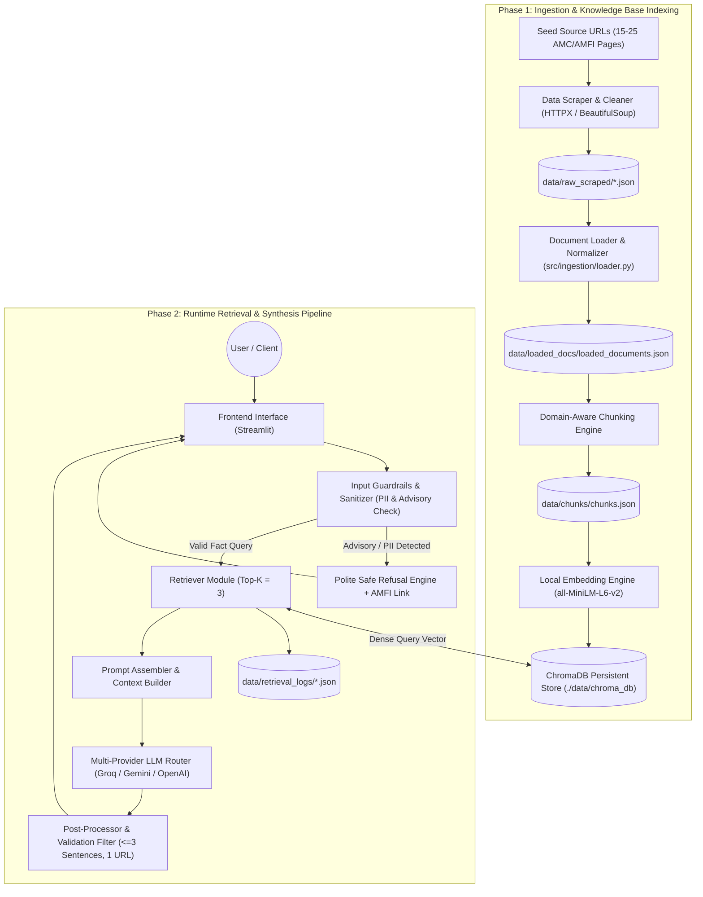
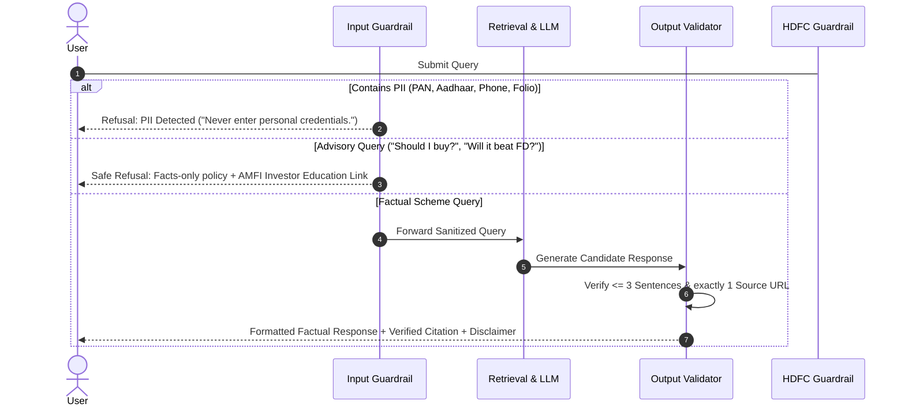
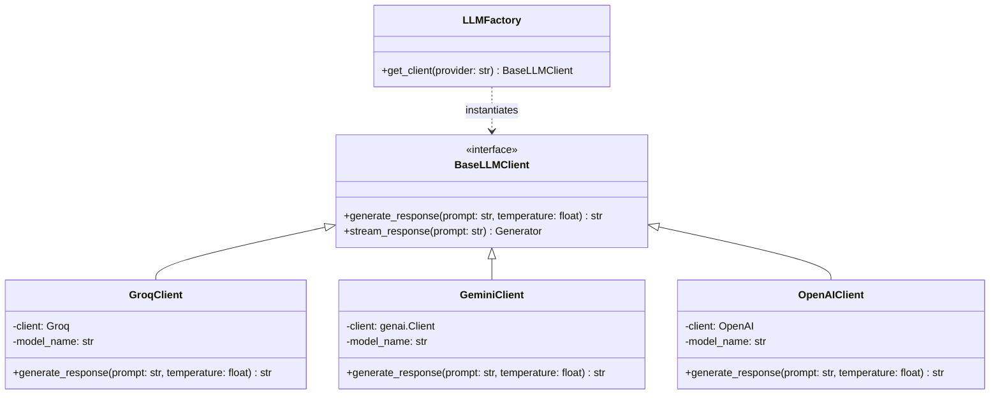

# Technical Architecture Document

## Mutual Fund FAQ Assistant (Groww)

---

| **Document Version** | 1.0.0 |
|---|---|
| **Status** | Approved / Ready for Implementation |
| **System** | Mutual Fund Scheme Facts & FAQ Assistant (Modular RAG) |
| **Reference Documents** | `Docs/PRD.md`, `Docs/ProblemStatement.txt` |
| **Primary Architecture Pattern** | Decoupled, Inspectable, Multi-Stage Retrieval-Augmented Generation (RAG) |

---

## 1. Architectural Overview & System Context

The **Mutual Fund FAQ Assistant** is engineered as a modular, auditable, and regulatory-compliant Retrieval-Augmented Generation (RAG) system. The solution ingests official public fund factsheets, scheme pages, and regulatory documentation to provide verified, facts-only answers with deterministic single-source citations.

### 1.1 Core Architectural Principles
1. **Auditable & Inspectable Stages:** Every transformation phase (Scraping $\to$ Chunking $\to$ Embedding $\to$ Vector Indexing $\to$ Retrieval $\to$ Synthesis) persists its intermediate artifacts on disk and exposes them through both an inspection API and the frontend UI.
2. **Deterministic Attribution:** Responses are grounded solely in retrieved context chunks; every factual response carries exactly one verified canonical source URL.
3. **Safety & Guardrails-First:** A multi-layered guardrail pipeline intercepts queries before retrieval (PII detection and advisory intent filtering) and validates generated output (sentence length, disclaimer adherence, and citation integrity).
4. **Provider Agnostic & Decoupled:** Abstracted interfaces for Embedding Models, Vector Databases, and LLM Providers ensure seamless portability between Groq, Google Gemini, OpenAI, Anthropic, and Mistral via centralized configuration (`config.yaml` and `.env`).

---

## 2. High-Level System Architecture



---

## 3. End-to-End Pipeline & Component Specifications

### 3.1 Stage 1: Data Ingestion & Extraction Engine (`src/ingestion/`)
- **Purpose:** Ingests official public mutual fund pages (Groww scheme pages, HDFC AMC portal, AMFI guidelines).
- **Execution Mechanism:** Headless HTTP fetch with `httpx` and `BeautifulSoup4` parser.
- **Extraction Targets:**
  - Scheme Header: Scheme Name, Category, Benchmark index.
  - Cost & Charges: Expense Ratio (Direct vs Regular), Exit Load criteria and tenure thresholds.
  - Investment Limits: Minimum SIP amount, Minimum Lumpsum.
  - Statutory Metadata: Lock-in periods (e.g., 3-year mandatory ELSS lock-in), Riskometer rating.
  - Operational Guides: Step-by-step procedures to download capital-gains statements.
- **Persistence Format:** `data/raw_scraped/{slug}.json`
  ```json
  {
    "source_url": "https://groww.in/mutual-funds/hdfc-large-cap-fund-direct-growth",
    "scheme_name": "HDFC Large Cap Fund Direct Growth",
    "category": "Large Cap",
    "scraped_timestamp": "2026-11-01T13:30:00Z",
    "raw_text": "...",
    "key_metrics": {
      "expense_ratio": "0.85%",
      "exit_load": "1% for redemption within 30 days",
      "min_sip": "100",
      "riskometer": "Very High",
      "benchmark": "NIFTY 50 TRI"
    }
  }
  ```

### 3.2 Stage 2: Domain-Aware Chunking Engine (`src/chunking/`)
- **Strategy:** Section-aware recursive Markdown chunking. Financial tables and scheme metric sections must not be split across chunk boundaries.
- **Chunk Parameters:**
  - Target Token Size: $350$ tokens.
  - Overlap: $50$ tokens.
  - Chunk Identifier: `{scheme_slug}_{section_name}_{index}`
- **Context Injection:** Every chunk prepends a canonical header line:
  `[Scheme: <Scheme Name> | Category: <Category> | Source: <Source URL>]`
- **Persistence Format:** `data/chunks/chunks.json`

### 3.3 Stage 3: Embedding Model Adapter (`src/embeddings/`)
- **Model:** `sentence-transformers/all-MiniLM-L6-v2` (384-dimensional dense vectors).
- **Device Support:** Automatic selection (`cpu` or `cuda`). Runs locally with zero remote API overhead.
- **Interface:** Pluggable wrapper interface implementing `embed_query(str)` and `embed_documents(List[str])`.

### 3.4 Stage 4: Vector Storage & Indexing (`src/vectordb/`)
- **Vector Engine:** ChromaDB (`chromadb` v0.5+).
- **Storage Mode:** Persistent local disk storage (`./data/chroma_db`).
- **Collection Name:** `mutual_fund_facts`.
- **Distance Metric:** Cosine similarity.
- **Stored Metadata:**
  ```json
  {
    "scheme_name": "HDFC Mid Cap Fund Direct Growth",
    "section": "Exit Load & Liquidity",
    "source_url": "https://groww.in/mutual-funds/hdfc-mid-cap-fund-direct-growth",
    "last_updated": "2026-11-01"
  }
  ```

### 3.5 Stage 5: Semantic Retrieval Engine (`src/retrieval/`)
- **Top-$K$ Strategy:** Retrieve top $K=3$ documents based on cosine distance.
- **Score Threshold Cutoff:** Cosine distance cutoff ($\le 0.35$, equivalent to similarity score $\ge 0.65$).
- **Metadata Pre-Filtering:** If query explicitly references a known scheme alias (e.g. "ELSS", "Mid Cap", "Flexi Cap"), an optional metadata `where` clause restricts candidate chunks.
- **Traceability:** Retrieved chunks and similarity scores are logged to `data/retrieval_logs/` for offline quality audits and runtime inspection.

### 3.6 Stage 6: Guardrails & Intent Classification (`src/guardrails/`)



#### Guardrail Components:
1. **PII Sanitizer & Filter:**
   - Evaluates input with strict regex patterns for Indian financial credentials:
     - PAN Card (`[A-Z]{5}[0-9]{4}[A-Z]{1}`)
     - Aadhaar Card (`\b[2-9]{1}[0-9]{3}[\\s]?[0-9]{4}[\\s]?[0-9]{4}\b`)
     - Indian Mobile Numbers (`\b[6-9]\d{9}\b`)
     - Bank Account & Folio Numbers
   - **Action:** Halts pipeline immediately with a polite security warning.
2. **Advisory / Speculative Intent Filter:**
   - Detects investment advice keywords: *"should i invest", "best fund", "buy or sell", "guaranteed return", "prediction", "which is better"*.
   - **Action:** Bypasses LLM retrieval, returns standardized refusal template:
     > *"I provide scheme facts only and do not offer investment advice or recommendations. You can explore scheme selection principles on official investor education portals: https://www.amfiindia.com/investor-corner/knowledge-center"*

### 3.7 Stage 7: LLM Synthesis Engine (`src/llm/`)
- **Primary Provider:** Groq API SDK.
- **Default Model:** `qwen/qwen3.8-27b` (configured in `.env` / fallback to `llama-3.3-70b-versatile`).
- **Pluggable Architecture:** A unified `BaseLLMClient` interface permits swapping between Groq, Google Gemini (`google-genai`), OpenAI (`openai`), Anthropic (`anthropic`), or Mistral (`mistralai`) without altering prompt or RAG code.
- **Prompt Structure:**
  ```text
  You are an objective Mutual Fund Facts Assistant for Groww.
  Your task is to answer user queries using ONLY the factual context provided below.
  
  CONSTRAINTS:
  1. Rely strictly on the provided context. If the fact is not in the context, say:
     "I do not have verified official facts for this specific detail."
  2. Answer in NO MORE THAN 3 SENTENCES.
  3. Include EXACTLY ONE source link at the end in the format:
     Source: <URL>
  4. Never provide investment advice, future predictions, or scheme comparisons.
  5. Include the date stamp line: "Last updated from sources: {date}"

  CONTEXT:
  {context_chunks}

  USER QUERY:
  {user_query}
  ```

### 3.8 Stage 8: Post-Processing & Output Validation (`src/guardrails/validator.py`)
- **Sentence Count Enforcer:** Verifies the answer contains $\le 3$ sentences (excluding citation and timestamp).
- **Single Source Normalizer:** Asserts that exactly one official URL exists in the response. If missing, it extracts the source URL from the top-ranked chunk.
- **Disclaimer Injection:** Ensures the mandatory disclaimer badge: `⚠️ Facts-only. No investment advice.` is appended or displayed.

---

## 4. Inspectable Stage-Wise Architecture (Auditable RAG)

To satisfy the explicit demonstration and audit requirements, the system persists data artifacts at each transition stage:

```
c:\builder\
├── data\
│   ├── raw_scraped\          # [Stage 1 Output] JSON files of scraped web pages
│   │   ├── hdfc_large_cap.json
│   │   ├── hdfc_flexi_cap.json
│   │   └── ...
│   ├── chunks\               # [Stage 2 Output] JSON array of chunked segments
│   │   └── chunks.json
│   ├── chroma_db\            # [Stage 4 Output] Persistent vector index
│   │   └── chroma.sqlite3
│   └── retrieval_logs\       # [Stage 5 Output] Runtime queries, hits, and scores
│       └── session_traces.jsonl
```

### UI Stage Inspection Panel (Streamlit Component)
The user interface features an interactive collapsible drawer:
- **Tab 1: Retrieved Chunks:** View the exact top-$K$ text blocks retrieved for the query with cosine similarity scores.
- **Tab 2: Source Metadata:** View the source URL, scraped timestamp, and scheme name.
- **Tab 3: Prompt & Tokens:** Inspect the exact assembled prompt sent to the LLM and the execution latency.

---

## 5. Directory Structure & Code Layout

```
c:\builder\
├── config\
│   ├── config.yaml            # Pipeline settings, chunk sizes, collection names
│   └── sources.json           # Curated list of 15-25 official scheme URLs
├── data\                      # Intermediate storage (inspectable)
│   ├── raw_scraped\
│   ├── chunks\
│   ├── chroma_db\
│   └── retrieval_logs\
├── Docs\
│   ├── ProblemStatement.txt
│   ├── PRD.md
│   └── architecture.md
├── src\
│   ├── __init__.py
│   ├── config.py              # Pydantic settings loader (.env + config.yaml)
│   ├── ingestion\             # Phase 1: Web scraping & sanitization
│   │   ├── __init__.py
│   │   ├── scraper.py
│   │   └── parsers.py
│   ├── chunking\              # Phase 2: Domain-aware chunking
│   │   ├── __init__.py
│   │   └── chunker.py
│   ├── embeddings\            # Phase 3: Sentence-Transformers embedding
│   │   ├── __init__.py
│   │   └── embedder.py
│   ├── vectordb\              # Phase 4: ChromaDB integration
│   │   ├── __init__.py
│   │   └── store.py
│   ├── retrieval\             # Phase 5: Query processing & Top-K retrieval
│   │   ├── __init__.py
│   │   └── retriever.py
│   ├── guardrails\            # Phase 6 & 8: PII & Advisory filter, output validator
│   │   ├── __init__.py
│   │   ├── pii_sanitizer.py
│   │   ├── advisory_filter.py
│   │   └── validator.py
│   ├── llm\                   # Phase 7: Multi-Provider LLM abstraction
│   │   ├── __init__.py
│   │   ├── base.py
│   │   ├── groq_client.py
│   │   └── factory.py
│   └── pipeline.py            # Central coordinator connecting all stages
├── ui\
│   └── app.py                 # Streamlit frontend with stage inspector
├── tests\
│   ├── test_ingestion.py
│   ├── test_guardrails.py
│   └── test_retrieval.py
├── .env.example
├── requirements.txt
├── README.md
└── run_pipeline.py            # CLI entrypoint to run ingestion & index
```

---

## 6. Multi-Provider LLM Abstraction Pattern

The application utilizes an abstract factory pattern to decouple model providers from business logic:



---

## 7. Data Contracts & Schemas

### 7.1 Chunk Data Contract
```python
from pydantic import BaseModel, HttpUrl
from typing import Optional, Dict

class ChunkMetadata(BaseModel):
    chunk_id: str
    scheme_name: str
    category: str
    section: str
    source_url: str
    last_scraped_at: str
    extra_attributes: Optional[Dict[str, str]] = {}

class TextChunk(BaseModel):
    content: str
    metadata: ChunkMetadata
```

### 7.2 Retrieval Query Result Contract
```python
from typing import List
from pydantic import BaseModel

class RetrievedChunk(BaseModel):
    content: str
    metadata: ChunkMetadata
    score: float  # Cosine similarity score [0.0 - 1.0]

class RetrievalResult(BaseModel):
    query: str
    chunks: List[RetrievedChunk]
    has_sufficient_context: bool
```

### 7.3 Assistant Response Contract
```python
from pydantic import BaseModel

class FAQResponse(BaseModel):
    answer: str
    source_url: Optional[str]
    last_updated: str
    is_refusal: bool
    refusal_reason: Optional[str] = None
    execution_latency_ms: float
    disclaimer: str = "Facts-only. No investment advice."
```

---

## 8. Configuration Specification

### 8.1 `config/config.yaml`
```yaml
app:
  name: "Groww Mutual Fund Facts Assistant"
  version: "1.0.0"
  disclaimer: "Facts-only. No investment advice."
  educational_url: "https://www.amfiindia.com/investor-corner/knowledge-center"
  max_sentences: 3

ingestion:
  timeout_seconds: 15
  output_dir: "./data/raw_scraped"
  sources_config: "./config/sources.json"

chunking:
  strategy: "recursive_markdown"
  target_tokens: 350
  overlap_tokens: 50
  output_path: "./data/chunks/chunks.json"

embedding:
  model_name: "sentence-transformers/all-MiniLM-L6-v2"
  device: "cpu"
  normalize_embeddings: true

vectordb:
  provider: "chromadb"
  persist_directory: "./data/chroma_db"
  collection_name: "mutual_fund_facts"
  top_k: 3
  similarity_threshold: 0.65

llm:
  provider: "groq"
  default_model: "qwen/qwen3.8-27b"
  fallback_model: "llama-3.3-70b-versatile"
  temperature: 0.0
  max_tokens: 250
```

### 8.2 Environment Variables (`.env`)
```bash
# LLM Providers
GROQ_API_KEY="gsk_..."
GEMINI_API_KEY=""
OPENAI_API_KEY=""
ANTHROPIC_API_KEY=""
MISTRAL_API_KEY=""

# Active Model Override
LLM_PROVIDER="groq"
LLM_MODEL="qwen/qwen3.8-27b"

# Pipeline Paths
CHROMA_PERSIST_DIR="./data/chroma_db"
```

---

## 9. Non-Functional Requirements & Performance Budget

| Parameter | Target Budget | Design Mitigation |
|---|---|---|
| **End-to-End Latency** | $\le 2.0$ seconds | Local fast embedding ($<40$ms), in-memory ChromaDB query ($<20$ms), Groq fast LPU inference ($<600$ms). |
| **Model Size / Footprint** | Local Embeddings $< 120$MB | `all-MiniLM-L6-v2` runs efficiently on commodity CPU without requiring GPUs. |
| **Reliability & Fallbacks** | 99.5% completion | Automatic model fallback in `LLMFactory` (Groq Qwen $\to$ Groq LLaMA $\to$ Secondary provider). |
| **Privacy Compliance** | 0 PII leakages | Regex-based sanitization executes before query touches retrieval or external APIs. No user query persistence. |

---

## 10. Execution Workflow & Traceability

1. **Setup & Ingestion Phase:**
   ```bash
   python run_pipeline.py --stage ingest --scrape-all
   python run_pipeline.py --stage chunk
   python run_pipeline.py --stage index
   ```
2. **Interactive UI Phase:**
   ```bash
   streamlit run ui/app.py
   ```
3. **Automated Verification:**
   ```bash
   pytest tests/
   ```

